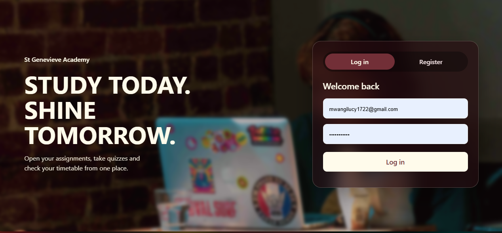
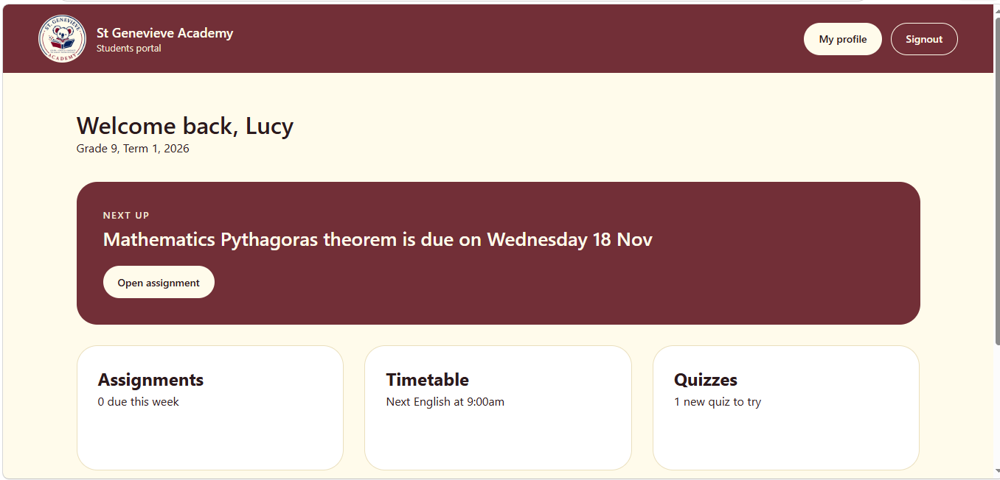

# Student Portal - Learning Made Simple
**Everything a student needs, in one place.**

---

## About the Project
The Student Portal is a website that gives students one simple place to see their work, take quizzes, watch lessons and track how they are doing. After logging in, each student sees only the content that belongs to their own grade. It is built so that a student can check what is due, practise on their own and see their progress all in one place.

## Project Goals
- Give students one clear place to find their assignments, quizzes and lessons.
- Show each student only the work for their own grade.
- Give instant marking and feedback so students learn from their mistakes.
- Help students keep track of deadlines and their own progress.
- Create a clean, easy-to-use experience on phones and computers.

## Features

### 1. Login
Students log in with their own account. The dashboard checks their login with the server (using a token) every time it loads, and sends them back to the login page if it is no longer valid.

### 2. Dashboard
Greets the student by name and shows their grade, term and year. It also shows:
- A **Next up** banner with the nearest unsubmitted assignment, written in plain words such as "due tomorrow" or "due on Wednesday 18 Nov".
- How many assignments are **due this week**.
- The student's **average grade** across all quizzes and assignments.

### 3. Assignments
- Shows only the assignments for the student's grade.
- Each card shows its subject, due date and a status: **To do**, **Due today**, **Due tomorrow**, **Overdue** or **Submitted**.
- Filter by status and by subject.
- A pop-up opens the multiple-choice questions, marks them straight away, and shows a review with correct answers in green and wrong answers in red.
- Cards are re-sorted after submitting, so unfinished work stays at the top.

### 4. Quizzes
- Timed practice quizzes in Mathematics, Science, English and Social Studies.
- A countdown timer and a progress bar that moves with every question.
- A score ring, a full review of every answer, and a **Redo quiz** button.
- **View results** brings back the student's last attempt at any time.

### 5. Video Lessons
- Video lessons with YouTube players built into the page.
- Filter lessons by subject.
- Mark lessons as watched.
- A notes box with a live word counter and a Clear button.

### 6. Announcements
- Filter tabs with a count on each tab.
- Pinned announcements for important news.
- Read more pop-ups that show the full announcement.

### 7. My Performance
- Overall average across quizzes and assignments.
- Number of assignments and quizzes completed.
- A progress bar for the average score in each subject.

### 8. Student Profile
Shows the student's name, ID, grade, term, year and an initials badge.

## Technologies Used
- HTML5
- CSS3
- JavaScript
- Browser storage (sessionStorage and localStorage)
- Google Apps Script (backend for login and profile)
- Git
- GitHub
- GitHub Pages

## How It Works
- **One list of assignments, many different cards.** Assignments are stored as data. JavaScript filters them by the student's grade, sorts them, and builds one card for each.
- **Status is worked out, not typed.** Each card checks whether the student has a saved result for it, and whether the due date has passed, to decide its status.
- **Every student has their own saved results.** Results are saved under the student's ID, so one student never sees another's marks.
- **Filters work by hiding.** Every card carries its status and subject as labels, and the filters hide the cards that do not match.
- **The timer is a countdown.** The quiz page counts down once every second and finishes the quiz automatically when time runs out.

## Getting Started

### View the Live Website
Visit the portal here:

[Open the Student Portal](https://tamilakaranja.github.io/student-portal/index.html)

### Run the Project Locally
Clone the repository:

```bash
git clone https://github.com/tamilakaranja/student-portal.git
```

Navigate to the project directory:

```bash
cd student-portal
```

Open the project folder in Visual Studio Code.

Open `index.html` in your browser, or use the Live Server extension in VS Code to preview the website.

Note: logging in needs the Google Apps Script backend, so the login only works when the backend address in the code is set up and online.

## Project Structure
The project contains HTML pages for each part of the portal, JavaScript files that make the pages work, stylesheets for the design, and folders for images and screenshots.

Example structure:

```
student-portal/
├── index.html
├── script.js
├── style.css
├── dashboard.html
├── dashboard.css
├── dashboard.js
├── assignments.html
├── assignments.css
├── assignments.js
├── assignments-data.js
├── quizzes.html
├── quizzes.css
├── quizzes.js
├── quiz.html
├── quiz.css
├── quiz.js
├── announcements.html
├── announcemnts.css
├── announcemnts.js
├── learning-resources.html
├── learning-resources.css
├── learning-resources.js
├── my-performance.html
├── performance.css
├── performance.js
├── profile.html
├── profile.css
├── profile.js
├── timetable.html
├── timetable.css
├── Images/
├── screenshots/
└── README.md
```

## Screenshots
The screenshots below show the main pages of the Student Portal.

**Login**


**Dashboard**


**My Performance**


## Current Limitations
- Quiz and assignment results are saved in the browser, so they stay on one device. They do not follow a student to another phone or computer, and teachers cannot see them yet.
- Quiz answers are stored inside the JavaScript file, so marking should move to the server.
- Watched videos and notes are not saved after the page is refreshed.
- The Next up banner only shows work that is not yet overdue.

## Future Improvements
- Save results on the server so they follow the student and teachers can see them.
- Do the marking on the server so answers cannot be read in the browser.
- Save watched videos and notes for each student.
- Show overdue work in the Next up banner.
- Add a search function for assignments and videos.
- Improve accessibility, navigation and responsiveness across phones, tablets and computers.

## Target Audience
The Student Portal is designed for students who need one clear place to manage their schoolwork, practise, and see how they are progressing.

## Project Purpose
The Student Portal shows how web development can support learning in a real school. It combines data-driven pages, filtering, timed quizzes, instant feedback and student progress tracking in one easy-to-use website.

## Author
Tamila Karanja, Zindua school

Hosted on GitHub Pages.

GitHub Repository: [student-portal](https://github.com/tamilakaranja/student-portal)